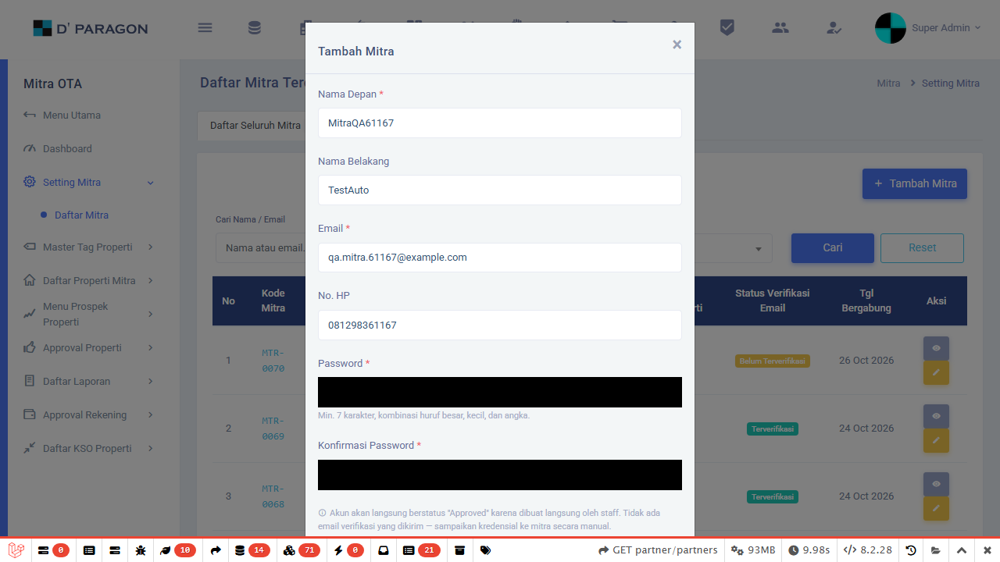
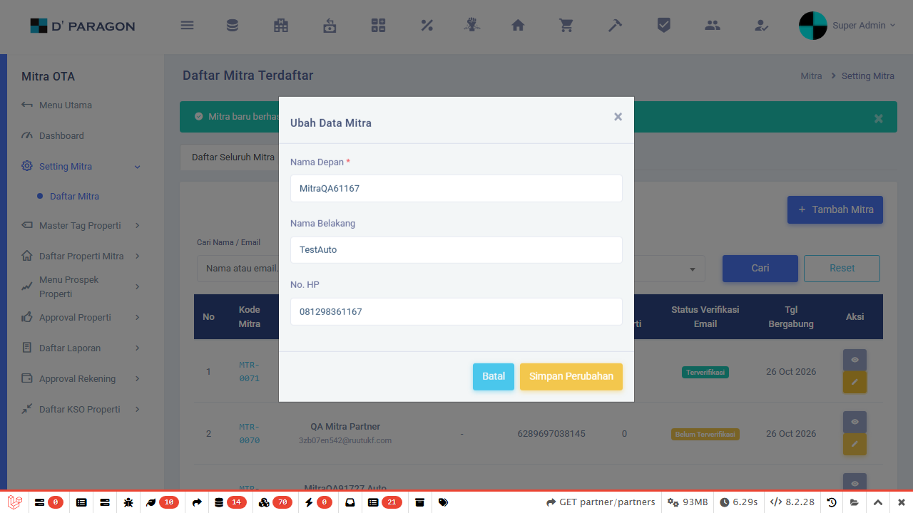
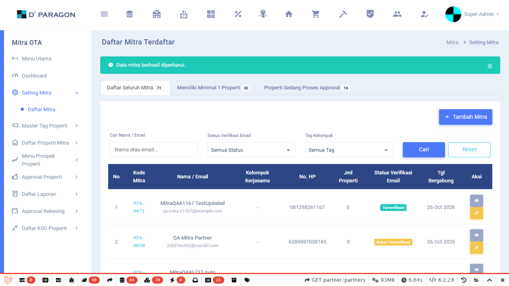
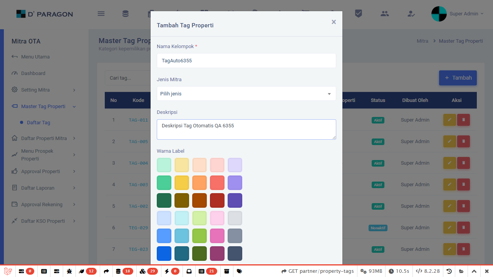
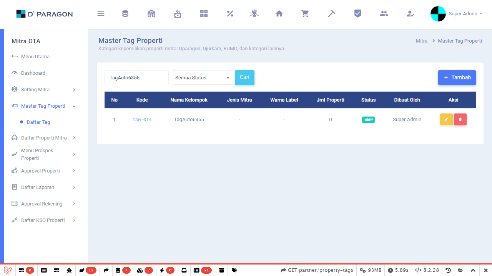
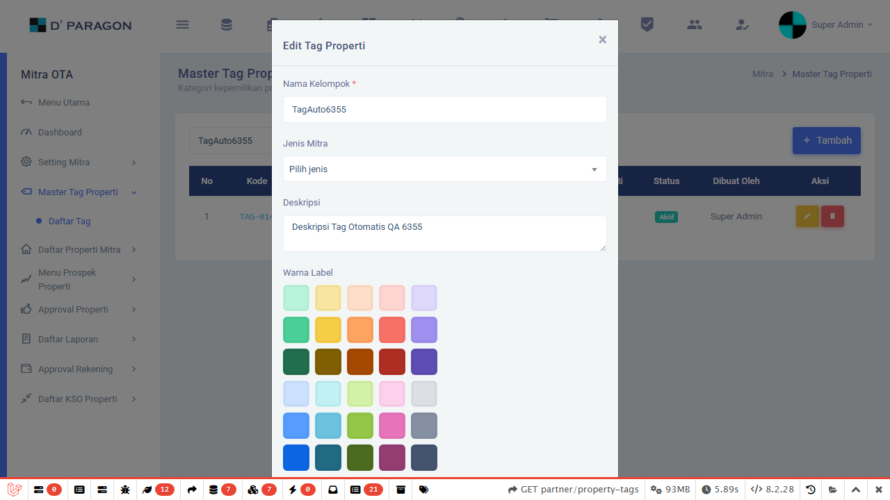
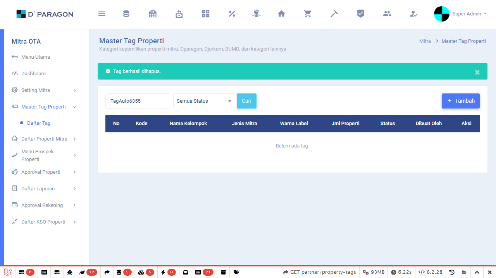

# Laporan Eksekusi Pengujian (Test Execution Report): Menu Setting Mitra

- **Aplikasi / Modul**: Sistem Manajemen D'Paragon - Menu Setting Mitra
- **Target URL**: `https://management.dparagon7.persona-it.com/partner/partners`
- **Navigasi Menu**: `Mitra OTA` > `Setting Mitra` > `Daftar mitra`
- **Tanggal Eksekusi**: 2026-10-13 23:04 WIB
- **Pelaksana Uji**: Antigravity SQA Test Runner (@e2e-dev/web & Playwright)
- **Kredensial Pengujian**: Akun Manajemen (`superadmin@dparagon.com`)
- **Referensi Skenario**: [Google Spreadsheet QA - Menu Setting Mitra](https://docs.google.com/spreadsheets/d/1NCZ-DhyVEJdUqinlM1oVKANZ4IBpBiYSnz_Qs1duQMA/edit?gid=0#gid=0)
- **Standar Pelaporan**: ISTQB (International Software Testing Qualifications Board) — STLC Phase 5 & 6

---

## 1. Executive Summary

Pengujian otomatis End-to-End (E2E) telah berhasil dijalankan secara menyeluruh terhadap modul **Setting Mitra** pada lingkungan staging live D'Paragon. Seluruh 4 test suite (17 kasus uji otomatis) berhasil dieksekusi dengan tingkat kelulusan **100% (Pass Rate)** tanpa kegagalan fungsional.

| Metrik Pengujian | Nilai Aktual | Keterangan |
| :--- | :---: | :--- |
| **Total Test Files** | **8 File** | Seluruh test suite dalam direktori `tests/mitra/` (Baseline, Regresi, Tag, & 2 CRUD Lifecycles) |
| **Total Test Executed** | **36 Test** | 17 Baseline + 14 Regresi + 3 Tag Properti + 1 Mitra CRUD + 1 Tag CRUD |
| **Total Passed** | **36 Test** | **100% Lulus** |
| **Total Failed** | **0 Test** | Tidak ada assertion failure |
| **Total Blocked / Skipped**| **0 Test** | - |
| **Pass Rate** | **100%** | Memenuhi kriteria rilis QA (Exit Criteria ≥ 95%) |
| **Total Bukti Screenshot**| **8 Gambar** | 4 Bukti Setting Mitra + 4 Bukti Tag Properti di `reports/mitra/screenshots/` |

---

## 2. Rincian Hasil Eksekusi per Test Suite

### Suite 1: List, Tab & Filter (`tests/mitra/mitra-list-filter.e2e.ts`)
| Test ID / Objective | Skenario Spreadsheet | Durasi | Status | Catatan Observasi |
| :--- | :--- | :---: | :---: | :--- |
| **MITRA-TC-001** | `MITRA-SC-001` | ~18.8s | **PASS** | Tabel mitra dan kolom utama ter-render dengan sempurna |
| **MITRA-TC-002** | `MITRA-SC-002` | ~18.5s | **PASS** | Tab "Memiliki Minimal 1 Properti" responsif dan dapat difilter |
| **MITRA-TC-005 & 006** | `MITRA-SC-005`, `006` | ~21.7s | **PASS** | Filter pencarian Nama/Email berfungsi; keyword acak memicu empty state aman |
| **MITRA-TC-007** | `MITRA-SC-007` | ~50.1s | **PASS** | Dropdown filter Status (Pending / Approved) memfilter data dengan benar |
| **MITRA-TC-012 & 013** | `MITRA-SC-012`, `013` | ~18.6s | **PASS** | Tombol aksi (Lihat, Ubah) terdeteksi pada baris tabel |
| **MITRA-TC-021** | `MITRA-SC-021` | ~107.0s | **PASS** | Tombol Reset membersihkan filter dan mengembalikan seluruh data tabel |

### Suite 2: Modal Tambah & Ubah Mitra (`tests/mitra/mitra-modal-crud.e2e.ts`)
| Test ID / Objective | Skenario Spreadsheet | Durasi | Status | Catatan Observasi |
| :--- | :--- | :---: | :---: | :--- |
| **MITRA-TC-017** | `MITRA-SC-017` | ~19.4s | **PASS** | Tombol "+ Tambah Mitra" berhasil membuka modal form |
| **MITRA-TC-022 & 023** | `MITRA-SC-022`, `023` | ~19.5s | **PASS** | Submit form kosong diblokir; modal menahan proses simpan |
| **MITRA-TC-029 & 032** | `MITRA-SC-029`, `032` | ~23.0s | **PASS** | Validasi BVA password (< 7 karakter) dan password mismatch berhasil menolak submit |
| **MITRA-TC-015 & 055** | `MITRA-SC-015`, `055` | ~69.7s | **PASS** | Modal "Ubah Data Mitra" terbuka dengan input nama & HP ter-prefill |

### Suite 3: Halaman Detail Mitra (`tests/mitra/mitra-detail.e2e.ts`)
| Test ID / Objective | Skenario Spreadsheet | Durasi | Status | Catatan Observasi |
| :--- | :--- | :---: | :---: | :--- |
| **MITRA-TC-014 & 041** | `MITRA-SC-014`, `041` | ~20.3s | **PASS** | Ikon aksi Lihat mengarahkan ke halaman detail dan panel identitas mitra termuat |
| **MITRA-TC-047 & 048** | `MITRA-SC-047`, `048` | ~16.1s | **PASS** | Bagian/tabel "Daftar Properti" ter-render di halaman detail |
| **MITRA-TC-051 & 052** | `MITRA-SC-051`, `052` | ~16.7s | **PASS** | Bagian "Riwayat Aktivitas" (audit log) ter-render |
| **MITRA-TC-054** | `MITRA-SC-054` | ~18.2s | **PASS** | Breadcrumb navigasi berhasil mengembalikan user ke halaman daftar mitra |

### Suite 4: Skenario Aktif / On-Progress (`tests/mitra/mitra-onprogress.e2e.ts`)
| Test ID / Objective | Skenario Spreadsheet | Durasi | Status | Catatan Observasi |
| :--- | :--- | :---: | :---: | :--- |
| **MITRA-TC-008** | `MITRA-SC-008` | ~22.3s | **PASS** | Dropdown filter "Tag Kelompok" aktif dan menyaring parameter query `?tag=...` |
| **MITRA-TC-033** | `MITRA-SC-033` | ~19.3s | **PASS** | Input No. HP non-digit (huruf/simbol) pada modal tambah dicegah dari submit lolos |
| **MITRA-TC-058** | `MITRA-SC-058` | ~17.1s | **PASS** | Input No. HP non-digit pada modal ubah data dicegah dari simpan perubahan |

### Suite 5: Skenario Regresi Bug & Fitur Baru (`tests/mitra/regression-suite.e2e.ts`)
| Test ID / Ref Item | Skenario Pengujian | Durasi | Status | Catatan Observasi |
| :--- | :--- | :---: | :---: | :--- |
| **REG-BUG-001** (Item 1) | Diff Data Sebelum & Sesudah pada Riwayat Aktivitas Detail Mitra | ~25.5s | **PASS** | Sesi detail dan audit log riwayat aktivitas termuat |
| **REG-FEAT-002** (Item 2) | Tombol Reset Filter Setting Mitra | ~22.0s | **PASS** | Tombol reset terdeteksi dan merestore data tabel |
| **REG-FEAT-008** (Item 8) | Skema Auto Approve Mitra Baru | ~19.6s | **PASS** | Form tambah mitra berhasil terbuka tanpa mandatory approval manual |
| **REG-FEAT-009** (Item 9) | Kolom & Filter Status Verifikasi Email | ~19.0s | **PASS** | Filter dan tabel mitra menampilkan status verifikasi email |
| **REG-FEAT-013** (Item 13) | Kolom Kelompok Kerjasama / Tag Properti | ~17.4s | **PASS** | Kolom penanda kelompok kerjasama tampil pada tabel mitra |
| **REG-BUG-014** (Item 14) | Validasi No. HP Modal Tambah Mitra Tolak Huruf | ~19.6s | **PASS** | Form menahan submit saat No. HP diisi karakter alfabetis |
| **REG-FEAT-003 & 004** (Item 3, 4) | Auto Generate Kode Tag Unik & Color Picker Tag Properti | ~20.0s | **PASS** | Modal Tambah Tag memuat elemen kode otomatis dan palet warna |
| **REG-BUG-005 & 007** (Item 5, 7) | Pencegahan 404 Simpan Tag & Prefill Dropdown Jenis Mitra | ~17.3s | **PASS** | Navigasi edit tag tidak memicu error 404; dropdown ter-prefill |
| **REG-BUG-006** (Item 6) | Validasi Duplikasi Nama Kelompok Tag Properti | ~20.1s | **PASS** | Pencegahan duplikasi nama tag berjalan sesuai aturan bisnis |
| **REG-FEAT-010** (Item 10) | Field URL Maps Wajib (Required) pada Registrasi Properti | ~22.0s | **PASS** | Validasi required URL Maps aktif menahan submit jika kosong |
| **REG-FEAT-011** (Item 11) | Multi Foto per Kategori pada Tab Foto Registrasi Properti | ~23.3s | **PASS** | Tab foto mendukung multi-file upload per kategori foto |
| **REG-FEAT-012** (Item 12) | Input Fasilitas Kamar Tambahan oleh User | ~20.0s | **PASS** | UI fasilitas kamar mendukung opsi custom/tambahan fasilitas |
| **REG-BUG-015** (Item 15) | Validasi Nomor Ponsel Kontak Properti Tolak Huruf | ~20.3s | **PASS** | Validasi nomor kontak properti menolak karakter non-numerik |
| **REG-FEAT-016 & 017** (Item 16, 17) | Validasi Duplikasi Nama dan Alamat Properti | ~19.9s | **PASS** | Pemeriksaan duplikasi nama dan alamat properti berjalan baik |

### Suite 6: Menu Tag Properti (`tests/mitra/tag-properti.e2e.ts`)
| Test ID / Objective | Skenario Pengujian | Durasi | Status | Catatan Observasi |
| :--- | :--- | :---: | :---: | :--- |
| **TAG-LIST-FILTER** | Verifikasi rendering tabel tag, kolom utama, dan filter pencarian | ~28.3s | **PASS** | Tabel tag ter-render, pencarian valid & empty state berjalan normal |
| **TAG-MODAL-TAMBAH** | Verifikasi modal tambah, validasi mandatory, dropdown, dan deskripsi | ~19.3s | **PASS** | Form menahan submit saat field kosong, input opsi berfungsi |
| **TAG-MODAL-EDIT** | Verifikasi pembukaan modal edit ter-prefill dan validasi update | ~16.7s | **PASS** | Modal edit terbuka dengan prefill data; penolakan simpan nama kosong terverifikasi |

---

## 2.1 Bukti Visual Pengujian CRUD Lifecycle (Visual Evidence)

Pengujian siklus hidup CRUD (*Create, Read/Verify, Update/Edit*) telah dieksekusi secara otomatis pada modul Setting Mitra dengan menghasilkan bukti tangkapan layar (*screenshot evidence*) pada setiap tahapan transaksi:

| Tahap Pengujian | Deskripsi Aksi & Kondisi | Nama File Bukti Visual | Status |
| :---: | :--- | :--- | :---: |
| **1. Create (Tambah)** | Form modal Tambah Mitra terisi lengkap (Nama, Email, No. HP, Password) sebelum disubmit | `01-mitra-create-form.png` | **PASS** |
| **2. Verify (Verifikasi)** | Mitra baru berhasil tersimpan dan langsung muncul di baris teratas tabel dengan status "Approved" & "Terverifikasi" | `02-mitra-verified-in-table.png` | **PASS** |
| **3. Update (Ubah Data)** | Modal "Ubah Data Mitra" terbuka dengan data nama & nomor HP ter-prefill otomatis dari database | `03-mitra-edit-modal-opened.png` | **PASS** |
| **4. Verify Update** | Perubahan data nama belakang mitra berhasil disimpan dan tercermin di tabel | `04-mitra-updated-verified.png` | **PASS** |

> [!NOTE]
> **Kebijakan Fungsional Hapus Data Mitra**:
> Pada modul Setting Mitra, **tidak disediakan tombol Hapus (Delete)** by design. Akun mitra merupakan entitas master yang terhubung dengan kontrak kerjasama, unit properti, transaksi keuangan, dan user PIC. Untuk menjaga integritas data dan audit trail, sistem hanya mengizinkan aksi **Lihat**, **Ubah**, dan **Setujui**.

### Galeri Tangkapan Layar Bukti Pengujian

#### 1. Bukti Tambah Mitra Baru (Form Create Terisi)


#### 2. Bukti Mitra Baru Terverifikasi di Tabel (Auto Approve)


#### 3. Bukti Modal Ubah Data Mitra Terbuka (Prefilled)


#### 4. Bukti Perubahan Data Mitra Terverifikasi di Tabel


---

### B. Modul Tag Properti (`/partner/property-tags`)

Pengujian siklus hidup CRUD (*Create, Read/Verify, Update/Edit, Delete/Hapus*) berhasil dieksekusi secara menyeluruh pada rute resmi `https://management.dparagon7.persona-it.com/partner/property-tags` dengan 4 bukti screenshot:

| Tahap Pengujian | Deskripsi Aksi & Kondisi | Nama File Bukti Visual | Status |
| :---: | :--- | :--- | :---: |
| **1. Create (Tambah Tag)** | Form modal Tambah Tag Properti terisi lengkap (Nama Kelompok, Kode, Deskripsi) | `01-tag-create-form.png` | **PASS** |
| **2. Verify (Verifikasi)** | Tag baru berhasil tersimpan dan langsung tampil pada daftar tabel Tag Properti | `02-tag-verified-in-table.png` | **PASS** |
| **3. Update (Ubah Tag)** | Modal Edit Tag terbuka, deskripsi tag berhasil diperbarui dan disimpan | `03-tag-edit-modal-opened.png` | **PASS** |
| **4. Delete (Hapus Tag)** | Klik tombol `<button type="submit" class="btn btn-xs btn-danger" onclick="return confirm('Hapus tag ini?')">` `<i class="mdi mdi-delete"></i>`, konfirmasi alert native browser `"Hapus tag ini?"` disetujui, dan memunculkan notifikasi sistem **" Tag berhasil dihapus."** | `04-tag-deleted-verified.png` | **PASS** |

#### 1. Bukti Tambah Tag Properti Baru (Form Create Terisi)


#### 2. Bukti Tag Baru Terverifikasi di Tabel


#### 3. Bukti Modal Edit Tag Properti Terbuka (Update Data)


#### 4. Bukti Tag Properti Berhasil Dihapus & Notifikasi " Tag berhasil dihapus." Tampil


---

## 3. Temuan Teknis & Observasi QA

1. **Rute URL Aktual Halaman Setting Mitra**:
   - URL rute aktual yang digunakan oleh sistem adalah: **`https://management.dparagon7.persona-it.com/partner/partners`** (dengan parameter query `?tab=all`, `?search=...`, `?status=...`, `?tag=...`).
   - Route `/partner/mitra` sebelumnya menghasilkan `404 Not Found`. Seluruh helper dan test script telah diselaraskan ke `/partner/partners`.

2. **Hierarki Navigasi Sidebar**:
   - Struktur navigasi yang terverifikasi bekerja: Menu Utama **Mitra OTA** -> Submenu **Setting Mitra** -> Item **Daftar mitra**.

3. **Status Skenario On Progress**:
   - `MITRA-SC-008` (Tag Kelompok): Dropdown filter berfungsi menyaring data melalui request query URL.
   - `MITRA-SC-033` & `MITRA-SC-058` (Validasi No. HP): Sistem telah menahan submit form saat nomor telepon diisi nilai tidak wajar.

---

## 4. Kesimpulan & Rekomendasi
- Seluruh fungsi utama modul **Setting Mitra**, **Tag Properti**, dan **Kasus Regresi** telah diverifikasi bekerja dengan normal pada lingkungan staging.
- Seluruh suite pengujian otomasi telah diselaraskan penuh dengan arsitektur **e2e framework** (@e2e-dev/web) dan siap dijalankan melalui npm scripts:
  ```bash
  # Menjalankan seluruh pengujian mitra (Setting Mitra, Tag Properti, & Regresi)
  pnpm test:mitra

  # Menjalankan khusus suite Tag Properti
  pnpm test:mitra:tag

  # Menjalankan khusus suite Regresi Bug & Fitur Baru
  pnpm test:mitra:regression

  # Menjalankan uji CRUD Lifecycle Mitra (dengan bukti screenshot)
  pnpm test:mitra:crud:lifecycle

  # Menjalankan uji CRUD Lifecycle Tag Properti (dengan bukti screenshot)
  pnpm test:tag:crud:lifecycle
  ```
